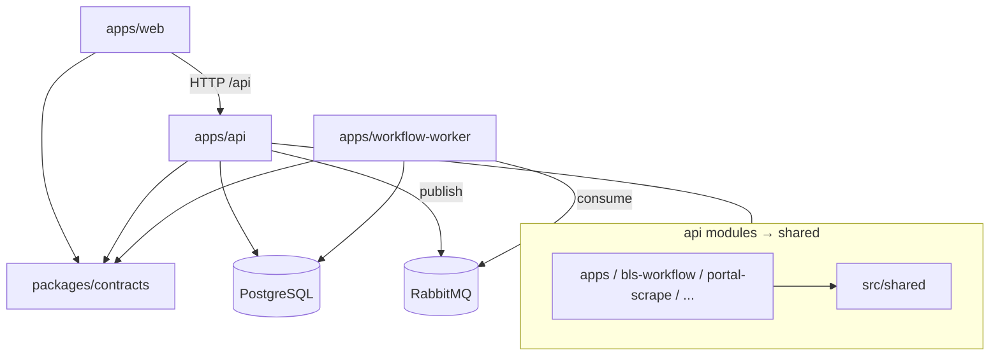

# Architecture

Where things live and how they depend on each other. Runtime commands belong in [`AGENTS.md`](../AGENTS.md). Event payload schemas and RabbitMQ catalog: [`docs/events.md`](./events.md).

**Codebase snapshot basis:** pnpm workspaces monorepo (`pnpm-workspace.yaml` + root `package.json` `workspaces`: `apps/*`, `packages/*`; `packageManager: pnpm@12.16.1`). Apps: `api`, `workflow-worker`, `web`. Packages: `contracts`, `config`, `database`, `domain-bls`. Migration CLI and operator commands: see [`AGENTS.md`](../AGENTS.md) (Migrations) and §1.5 below.

**Bootstrap inputs:** `specs/_bootstrap/decisions.md` is present (D1 accepted: document as-is; D2 and D3 status open, with no decision statement). `specs/_bootstrap/discovery.md` and `discovery-followup.md` are absent. Closed roles-and-applications specs are present and archived 2026-11-01: `specs/roles-and-applications/spec.md`, `specs/roles-and-applications-frontend/spec.md`. `docs/sdd/00-current-state.md` and `docs/sdd/frontend/00-discovery.md` are historical BLS snapshots (stale `backend/` / `web/` path names). Structural claims below prefer live paths under `apps/` and `packages/`. Decision **D3** has no statement text (see [Risks](#6-risks)).

---

## 1. Backend architecture

Two NestJS processes share TypeORM entities and messaging contracts but different module graphs:

| Process | Package | Entry | Role |
|---------|---------|-------|------|
| Business API | `@vises/api` | `apps/api/src/main.ts` (port `8100`) | CRM/staff HTTP under global prefix `api`; publishes workflow bus messages; no Patchright runner |
| Workflow worker | `@vises/workflow-worker` | `apps/workflow-worker/src/main.ts` (port `8101` / `PORT` / `WORKER_PORT`) | Claim/runner + browser fill/clients; RabbitMQ consumer; minimal health HTTP |

Root wiring: `apps/api/src/app.module.ts`, `apps/workflow-worker/src/app.module.ts`.

### 1.1 API module map (`apps/api/src/modules/`)

| Module | Path | Responsibility | Public surface | `imports:` |
|--------|------|----------------|----------------|------------|
| `config` | `modules/config/` | Global Nest `ConfigModule` + Zod `appEnvSchema` | `AppConfigModule` | `ConfigModule.forRoot` |
| `logger` | `modules/logger/` | Global Winston logger + HTTP access interceptor | `WinstonLoggerService`, `APP_LOGGER` | (none) |
| `database` | `modules/database/` | TypeORM root + entity registration + `SchemaBootstrap` | `TypeOrmModule` | `TypeOrmModule.forRootAsync` / `forFeature` |
| `seed` | `modules/seed/` | Demo seed when DB empty | `SeedService` | TypeORM `User`, `Application`, `Setting` |
| `health` | `modules/health/` | Liveness HTTP | `HealthController` (`@Controller()`) | (none) |
| `messaging` | `modules/messaging/` | Global RabbitMQ **publisher** | `WorkflowBusPublisherService` | (none; `@Global`) |
| `auth` | `modules/auth/` | JWT session; staff roles `superadmin` / `admin` / `agent` (`USER_ROLES` aliases contracts `STAFF_ROLES`; public register defaults to `agent`) | `AuthController`, `InviteController`; exports `AuthService`, `JwtTokenService`, `JwtAuthGuard`, `RolesGuard` | TypeORM `User` |
| `users` | `modules/users/` | Staff user admin; role ACL beyond the controller guard (see below) | `UsersController`; exports `UsersService` | TypeORM `User`/`Application`, `AuthModule` |
| `balance` | `modules/balance/` | Agent balance top-up, manual adjust, ledger read, exported debit-with-lock | `BalanceController` (`agents/:agentId/balance`); exports `BalanceService`, `BalanceAuditService` | TypeORM `User`/`BalanceTransaction`, `AuthModule` |
| `apps` | `modules/apps/` | Applications / visits / payments HTTP; workflow arm + bus publish on upsert | `AppsController`, `VisitsController`, `PaymentsController`; exports `AppsService` | TypeORM `Application`/`User`, `AuthModule`, `UsersModule`, `BlsWorkflowModule`, `PortalScrapeModule` |
| `applications` | `modules/applications/` | Staff status transitions + status-history read + visa-center monitor (list/CRUD stays on `apps`) | `ApplicationsController`, `VisaCenterMonitorController`; exports `ApplicationsService` | TypeORM `Application`/`ApplicationStatusHistory`/`Client`/`User`, `AuthModule` |
| `clients` | `modules/clients/` | Client create, masked list/detail, passport fill, delete; passport ciphertext via `PiiModule` | `ClientsController`; exports `ClientsService` | TypeORM `Client`/`Application`/`ApplicationStatusHistory`/`BalanceTransaction`/`User`, `AuthModule`, `BalanceModule`, `PiiModule`, `SettingsModule` |
| `settings` | `modules/settings/` | Company settings | `SettingsController`; exports `SettingsService` | TypeORM `Setting`/`User`, `AuthModule`, `SeedModule` |
| `stats` | `modules/stats/` | Dashboard stats (`GET stats/dashboard`); roles `admin` \| `superadmin` \| `agent`. Analytics module comment calls this the legacy stats route | `StatsController`; exports `StatsService` | TypeORM `Application`/`User`, `AuthModule` |
| `analytics` | `modules/analytics/` | Roles-and-applications aggregates (`GET stats/roles-applications`); coexists with `stats` | `AnalyticsController`; exports `AnalyticsService` | TypeORM `Application`/`Client`/`ApplicationStatusHistory`/`User`, `AuthModule` |
| `bls-workflow` | `modules/bls-workflow/` | Durable workflow **control/read** HTTP + repos/locks/reconcile (no runner) | `BlsWorkflowController`; exports services/repo/lock/abort/cleanup | TypeORM workflow entities + `Application`/`User`, `AuthModule`, `BlsSecretsModule`, `TemporaryEmailModule` |
| `bls-secrets` | `modules/bls-secrets/` | Envelope crypto + vault (leaf) | Exports `SecretsCryptoService`, `BlsSecretVaultService` | TypeORM `BlsSecretVault` |
| `pii` | `modules/pii/` | Passport PII AES-256-GCM (`iv:authTag:ciphertext`), Winston read audit, retention cron (`@nestjs/schedule`) | Exports `PiiCryptoService`, `PiiAuditService` | `ScheduleModule`, TypeORM `Client` |
| `temporary-email` | `modules/temporary-email/` | API bindings: **NoOp** mailbox provider for terminal cleanup | Exports NoOp + DI tokens | (none) |
| `portal-core` | `modules/portal-core/` | Portal config/data/mapper/site adapter + autofill-run persistence | Exported portal services + DI tokens | TypeORM `Application`, `PortalAutofillRun`, `BlsWorkflowStep` |
| `portal-scrape` | `modules/portal-scrape/` | API façade: autofill evidence list/download + login-prep reject; boot autofill reconcile | `PortalAutofillController`, `PortalLoginPrepController`; exports autofill/login-prep services + re-exports `PortalCoreModule`, `BlsWorkflowModule` | TypeORM entities, `AuthModule`, `PortalCoreModule`, `BlsWorkflowModule` |
| `proxy6` | `modules/proxy6/` | Proxy6 admin HTTP + inventory/lease services | `Proxy6Controller`; exports API/inventory/lease services | `HttpModule`, TypeORM `Proxy6Proxy`/`User`, `AuthModule` |

`BlsSecretsModule`, `TemporaryEmailModule`, and `PortalCoreModule` are pulled in transitively (not listed on `AppModule` itself). `AppModule` does import `AuthModule`, `UsersModule`, `BalanceModule`, `ClientsModule`, `ApplicationsModule`, `AnalyticsModule`, and `PiiModule` directly (`apps/api/src/app.module.ts`).

**Auth HTTP (roles `superadmin` / `admin` / `agent`):** `AuthController` — `POST /api/auth/login`, `POST /api/auth/register`, `POST /api/auth/demo`, `GET /api/auth/me` (JWT; returns contracts `UserMeDto`). `InviteController` — `GET /api/invite/:token`. Role constants live in `modules/auth/constants/roles.constants.ts` and alias contracts `STAFF_ROLES` (`packages/contracts/src/constants/staff-role.constants.ts`). `GET /api/auth/me` field rules are in §4.1.

**Users ACL:** Controller routes require `admin` or `superadmin`, except `GET /api/users/managers`, which also allows `agent`. `assertCanMutateUser` (`modules/users/utils/assert-can-mutate-user.util.ts`): superadmin may patch, reissue, or delete any staff user; admin may mutate agents only; otherwise `forbidden_role`. `assertCanAssignStaffRole`: assigning `admin` requires a superadmin actor; creating or promoting to `superadmin` through the API is forbidden (`forbidden_role`, or `superadmin_exists` when a superadmin already exists). Keeping an existing superadmin role unchanged is allowed.

**Balance HTTP:** `POST /api/agents/:agentId/balance/top-up` and `POST /api/agents/:agentId/balance/adjust` — `admin` | `superadmin` (`BalanceTopUpDto` / `BalanceAdjustDto` → `BalanceTransactionDto` in `@vises/contracts`). `GET /api/agents/:agentId/balance/transactions` — `admin` | `superadmin` | `agent`. `assertCanReadLedger`: admin and superadmin may read any agent; an agent may read only `actorId === agentId`. `BalanceModule` exports debit-with-lock for `ClientsModule`.

**Analytics HTTP:** `GET /api/stats/roles-applications` returns contracts `AnalyticsDto` for `admin` | `superadmin` | `agent`. `parseAnalyticsDateRange` treats omitted `from` and `to` as current totals (`null` range). Legacy `GET /api/stats/dashboard` stays on `StatsModule`.

**Staff status history and status change:** `GET /api/applications/:applicationId/history` on `ApplicationsController`. JWT roles `admin` | `superadmin` | `agent`; agent may read only applications owned by their clients; admin/superadmin any. Empty history → `{ items: [] }` (not 404); missing application → 404 `application_not_found`; ACL failure → 403 `forbidden_role`. Items ordered `createdAt` ASC. Wire shapes `ApplicationStatusHistoryDto` / `ApplicationStatusHistoryResponseDto` in `@vises/contracts` (`packages/contracts/src/types/application-status-history.types.ts`). Reads existing `ApplicationStatusHistory` only. No plaintext PII on the wire; contract optional `reason` is omitted (entity has no reason column). `POST /api/applications/:applicationId/status` uses the same three roles and returns contracts `ApplicationDto` from `ApplicationStatusChangeDto`.

**Clients HTTP (T15.3 — Decision 2A):** `modules/clients/` — `GET /api/clients` → `ClientListDto[]` (`maskedPassport` single mask string, e.g. `AB****67`; no plaintext passport fields; `firstName`/`lastName` non-null empty-string defaults). `GET /api/clients/:id` → `ClientDetailDto` with decrypted FR-6 plaintext; Winston PII audit on every detail decrypt (same `PiiModule` pattern as passport read). Agent sees own clients only; admin/superadmin all; cross-tenant agent → 403 `forbidden_role`. `PATCH /api/clients/:id/passport` accepts `ClientPassportUpdateDto`; without client-creation debit ledger → 409 `passport_not_unlocked`. Companion `GET /api/clients/:id/passport` retained. Create / passport-update responses stay masked `ClientDto` for minimal churn. Wire types in `@vises/contracts` (`packages/contracts/src/types/client.types.ts`).

### 1.2 Worker module map (`apps/workflow-worker/src/modules/`)

| Module | Path | Responsibility | Public surface | Notable `imports:` |
|--------|------|----------------|----------------|-------------------|
| `config` / `logger` / `database` / `health` | same names as API | Same concerns; worker health only | Health HTTP | As API |
| `messaging` | `modules/messaging/` | RabbitMQ **consumer** (run + abort queues) | `WorkflowBusConsumerService` | `BlsWorkflowModule` |
| `bls-workflow` | `modules/bls-workflow/` | Runner, task executor, repos/locks (no HTTP controllers) | Exports runner/executor/services | `BlsClientsModule`, `BlsSecretsModule`, `BrowserMailModule`, `PortalCoreModule` |
| `bls-clients` | `modules/bls-clients/` | Domain clients REGISTER…BOOK + proxy adapter | Client services + DI tokens | `PortalFillModule`, `PortalCoreModule`, `BlsSecretsModule`, `BrowserMailModule`, `Proxy6Module` |
| `portal-fill` | `modules/portal-fill/` | Patchright fill pipelines + captcha adapter | Fill services + tokens | `PortalCoreModule`, `BrowserMailModule`, `CapMonsterModule` |
| `portal-core` | `modules/portal-core/` | Shared portal leaf (+ browser session budget on worker) | Portal services | TypeORM portal/workflow entities |
| `capmonster` | `modules/capmonster/` | CapMonster captcha solver | `CapMonsterService` / `CAPTCHA_SOLVER` | (none) |
| `browser-mail` | `modules/browser-mail/` | tempmail.plus as `TEMPORARY_EMAIL_PROVIDER` | Adapter + session store | `PortalCoreModule` |
| `temporary-email` | `modules/temporary-email/` | Port tokens only (empty Nest module) | Tokens via barrel | (none) |
| `bls-secrets` | `modules/bls-secrets/` | Same leaf crypto/vault as API | Crypto + vault services | TypeORM `BlsSecretVault` |
| `proxy6` | `modules/proxy6/` | Lease/API/inventory **without** admin controller | Lease services | `HttpModule`, TypeORM `Proxy6Proxy` |

### 1.3 `apps/api/src/shared/*`

Layout note: `.cursor/rules/nestjs-structure.mdc` describes ideal `shared/database`, `shared/messaging`, `shared/config`, `shared/logger`. **In code**, database, messaging, config, and logger are **feature modules** under `src/modules/`. `shared/` holds cross-cutting Nest/utils only:

| Concern | Path | Responsibility | Consumers (examples) |
|---------|------|----------------|----------------------|
| Guards | `shared/guards/roles.guard.ts` | Role authorization | Controllers via `AuthModule` re-export; `RolesGuard` also registered in `AuthModule` |
| Decorators | `shared/decorators/` (`roles`, `current-user`) | Param/metadata helpers | Controllers across apps/users/settings/portal/proxy6/bls-workflow |
| Filters | `shared/filters/detail-exception.filter.ts` | Global `{ detail }` error JSON | Registered in `apps/api/src/main.ts` |
| Mappers | `shared/mappers/` | Entity → API out shapes | `auth`, `apps`, `users`, `settings` services |
| Types | `shared/types/` | Shared out/pagination types | Apps/users modules |
| Constants | `shared/constants/` | Pagination, password, upload, invite | Controllers/services |
| Utils | `shared/utils/` | Pure helpers (hash/check password, pagination, uid, uploads, dates, feature-agnostic AES-256-GCM colon-format seal/open) | Many modules; `modules/pii` for PII wire format |
| Interceptors / pipes | — | **Not** under `shared/`; HTTP access log interceptor lives in `modules/logger/` | — |
| Database / messaging / config / logger | — | Live under `modules/*` (see above), not `shared/` | — |

Worker copies a parallel `apps/workflow-worker/src/shared/` tree (same shape).

### 1.4 Dependency direction

**Intended (rule):** feature modules → `shared`; never `shared` → `modules` (`.cursor/rules/nestjs-structure.mdc`).

**Violations (shared imports TypeORM entities from `modules/database`):**

| File | Imports from |
|------|----------------|
| `apps/api/src/shared/decorators/current-user.decorator.ts` | `modules/database/entities/user.entity` |
| `apps/api/src/shared/guards/roles.guard.ts` | `modules/database/entities/user.entity` |
| `apps/api/src/shared/mappers/user.mapper.ts` | `modules/database/entities/user.entity` |
| `apps/api/src/shared/mappers/app.mapper.ts` | `modules/database/entities/application.entity` |
| `apps/api/src/shared/mappers/extras-out.mapper.ts` | `modules/database/entities/application.entity` |
| `apps/api/src/shared/mappers/settings.mapper.ts` | `modules/database/entities/setting.entity` |

Same pattern exists under `apps/workflow-worker/src/shared/` (mirrored files).

**Module → module:** Nest `imports: [OtherModule]` is used (e.g. `AppsModule` → `BlsWorkflowModule` / `PortalScrapeModule`). `BlsClientsModule` deliberately does **not** import `BlsWorkflowModule` (cycle break; documented in module comment).

### 1.5 TypeORM

| Topic | Fact |
|-------|------|
| Data source | Nest `TypeOrmModule.forRootAsync` in `apps/api/src/modules/database/database.module.ts` and the worker twin; `type: 'postgres'`, `url` from `DATABASE_URL` |
| Entity discovery | Explicit `ENTITIES` array in that module (not glob). Entity files: `apps/api/src/modules/database/entities/*.entity.ts` (API is schema authority; worker entity set aligned in T12) |
| Entities (API + worker) | `User`, `Application`, `Setting`, `Client`, `BalanceTransaction`, `ApplicationStatusHistory`, `PortalAutofillRun`, `Proxy6Proxy`, `BlsWorkflow`, `BlsWorkflowStep`, `BlsWorkflowTask`, `BlsWorkflowAttempt`, `BlsWorkflowEvent`, `BlsSecretVault` (worker entity set aligned in T12) |
| Migrations folder | `apps/api/src/modules/database/migrations/` — TypeORM migrations; CLI DataSource: `apps/api/src/modules/database/typeorm.datasource.ts` (compiled to `dist/` for CLI) |
| `synchronize` | **`false` permanently** in both API and worker `database.module.ts` (roles-and-applications T2.5). Schema changes go through migrations, not boot-time sync. |
| Post-connect | `SchemaBootstrap` (`schema.bootstrap.ts`) still runs on module init for indexes / constraints / legacy cleanup TypeORM migrations cannot express cleanly (e.g. partial unique `uq_users_one_superadmin`) |

**How migrations are managed**

1. Edit API entities under `apps/api/src/modules/database/entities/` (shared DB source of truth).
2. Generate: `pnpm --filter @vises/api run migration:generate` (builds, then `typeorm migration:generate … -d ./dist/modules/database/typeorm.datasource.js` with env from `apps/api/.env.dev.local` via dotenv-cli).
3. Review the generated SQL by hand; apply with `pnpm --filter @vises/api run migration:run` (or `migration:run:fake` only when the schema already matches and you must record the row without executing DDL).
4. Nest apps do **not** auto-run migrations on boot; operators run CLI before/with deploy. Both processes keep `synchronize: false` so dual-process sync cannot rewrite the shared schema.

Baseline (T2.5): `apps/api/src/modules/database/migrations/1793220132990-BaselineSchema.ts` is the baseline migration. It was fake-applied (`migration:run:fake`) because the shared schema already matched, so the migration row is recorded without re-executing that DDL. This archive did not re-query the live `migrations` table.

**Full operational reset (destructive).** `clearAllOperationalTables` (`apps/api/src/modules/database/utils/clear-all-operational-tables.util.ts`) runs `TRUNCATE TABLE … RESTART IDENTITY CASCADE` over `FULL_DB_RESET_TABLES` (`modules/database/constants/full-db-reset-tables.constants.ts`). The helper does not take a backup. `SeedService.resetDemo` calls it, then seeds. HTTP entry: `POST /api/settings/reset-demo` (`admin` | `superadmin`) when demo controls are enabled; otherwise settings throws 403. Human approval is required before anyone runs this path.

Human approval is required before schema changes (entities / migrations / `SchemaBootstrap`). `synchronize: false` is permanent in both API and worker `database.module.ts`. Future schema changes are migrations only: `pnpm --filter @vises/api run migration:generate`, `migration:run`, and `migration:run:fake` (fake only when the live schema already matches and the row must be recorded without DDL). Do not re-enable `synchronize`. There is no current synchronize workflow.

`@vises/database` (`packages/database`) remains a **skeleton** (`DATABASE_PACKAGE_STATUS` only); entities have not moved there yet.

### 1.6 RabbitMQ

Implemented. Topology, producers, consumers, idempotency, retry/DLQ, and outbox status are documented in [`docs/events.md`](./events.md). Summary:

| Item | Value |
|------|--------|
| Exchange | `vises.workflow` (topic, durable) |
| Queues | `workflow-worker.run`, `workflow-worker.abort` |
| Routing keys | `workflow.created` / `schedule` / `resume` / `retry` / `abort` (`@vises/contracts` `WORKFLOW_ROUTING_KEYS`) |
| Producer | API `WorkflowBusPublisherService` (`modules/messaging/`) |
| Consumer | Worker `WorkflowBusConsumerService` |
| Envelope | `{ correlationId, payload }` |
| Outbox | **Not present** |
| DLQ | Constant `vises.workflow.dlq` **unused**; `nack(..., requeue=false)` with no dead-letter args |
| Bus idempotency | No processed-message store; durable claim via DB `nextRunAt` / locks |

Payload schemas: **`docs/events.md`** + `packages/contracts/src/types/workflow-message.types.ts`.

---

## 2. Frontend architecture (`apps/web`)

FSD under `apps/web/src/`. No dedicated FSD `.mdc` file; segment placement is in `.cursor/rules/file-separation.mdc` (frontend specifics). Component style: `.cursor/rules/react-components.mdc`.

Directories present under `apps/web/src` (working tree, 2026-11-01): `app`, `assets`, `entities`, `features`, `pages`, `shared`, `widgets`. FSD layers are `app`, `pages`, `widgets`, `features`, `entities`, `shared`. `assets/` is not an FSD layer.

### 2.1 Layer / slice map

| Layer | Path | Slices present | Responsibility |
|-------|------|----------------|----------------|
| `app` | `src/app/` | `providers/`, `guards/`, `App.tsx`, `main.tsx` | Bootstrap, router, `AppProviders`, `RoleGuard` |
| `pages` | `src/pages/` | `landing`, `register`, `analytics`, `clients`, `agents`, `balance`, `applications`, `application-detail`, `settings`, `users` | Route screens |
| `widgets` | `src/widgets/` | `shell`, `app-store` | App chrome; transitional `StoreProvider` |
| `features` | `src/features/` | `analytics-filters`, `application-form`, `application-status-change`, `auth-login`, `auth-register`, `balance-adjust`, `balance-top-up`, `client-create`, `client-passport-edit`, `language-switch`, `settings-price-edit`, `users-admin` | Forms and interactions |
| `entities` | `src/entities/` | `analytics`, `application`, `balance`, `client`, `session`, `settings`, `user` | Domain UI, fetch helpers, session |
| `shared` | `src/shared/` | `api/`, `i18n/`, `lib/`, `testing/`, `theme/`, `ui/` | HTTP client, i18n, theme, UI kit |

`App.tsx` mounts `/`, `/register`, `/app/*` (`agent`), and `/admin/*` (`superadmin` | `admin`).

### 2.2 Import direction and slice isolation

Higher layers may depend on lower layers (`app` → `pages` → `widgets` → `features` → `entities` → `shared`). Cross-imports between sibling slices should go through public slice APIs (`index.ts` barrels) rather than deep internals. Segment placement inside a slice: `ui/`, `model/`, `api/`, `lib/`, `config/` per `.cursor/rules/file-separation.mdc`. There is no separate FSD rule file under `.cursor/rules/`.

### 2.3 State ownership

| Kind | Where | Notes |
|------|-------|-------|
| Server state | TanStack Query | `@tanstack/react-query` is a dependency of `@vises/web`. `createAppQueryClient` (`apps/web/src/shared/api/utils/create-app-query-client.util.ts`) sets `queries.retry: false` and `queries.refetchOnWindowFocus: false`, and does not persist the cache to web storage. `AppProviders` (`apps/web/src/app/providers/AppProviders.tsx`) owns that client via `QueryClientProvider` and calls `queryClient.clear()` on session change. Query keys are defined at call sites. This document does not catalogue them. |
| Session | `entities/session` `SessionProvider` | JWT and session JSON in `sessionStorage`; `setApiTokenProvider` reads the token for `shared/api` |
| Theme | `shared/theme` | Separate from the query cache; see §2.5 |
| Transitional client store | `widgets/app-store` `StoreProvider` | Still mounted inside `AppProviders`, under the query client |

### 2.4 API client and `@vises/contracts`

| Piece | Path |
|-------|------|
| HTTP helpers | `apps/web/src/shared/api/http-client.ts` (`apiRequest`, `apiRequestRaw`, `fetchApiBlob`) |
| URL builder | `shared/api/utils/build-api-url.util.ts` — DEV relative `/api…` (Vite proxy); prod `${appBase()}/api…` |
| Auth header | `setApiTokenProvider` → `sessionStorage` JWT (`SessionProvider`) |
| Contracts package | **Consumed.** `@vises/web` `package.json` depends on `@vises/contracts` (`workspace:*`). Pages, entities, and features import HTTP DTO types from that package. `shared/api/types/contracts.types.ts` re-exports a subset (analytics, balance, client, settings, `UserMeDto`, status-history, error codes). |
| Residual local session DTO | `AuthSessionDto` / `AuthSessionUserDto` in `apps/web/src/shared/api/types/auth-session.types.ts` are not in `@vises/contracts`. Residual debt is logged in `specs/roles-and-applications-frontend/tasks.md` (FE4.debt-1). |

### 2.5 Theme

`apps/web/src/shared/theme` owns theme mode. `THEME_MODES` is `light` | `dark` | `system`. Default mode is `system` (`THEME_DEFAULT_MODE`). The preference is stored under `localStorage` key `vises.theme` (`THEME_STORAGE_KEY`). `main.tsx` calls `bootstrapTheme()` before render, then wraps the tree in `ThemeProvider`. The provider follows `prefers-color-scheme` when mode is `system`. `applyDocumentTheme` sets `document.documentElement` class `dark` when the effective theme is dark, sets `dataset.theme` to the selected mode, and sets `style.colorScheme` to the effective theme. `ThemeControl` in `apps/web/src/shared/ui` calls `useTheme`.

Binding tokens live in `apps/web/src/index.css`: `--vises-*` custom properties on `:root`, with `.dark` overrides, mapped through Tailwind v4 `@theme` (`--color-*`, radius, shadow). The UI kit is `apps/web/src/shared/ui` (`Logo`, `StatusBadge`, `Avatar`, `Card`, `Field`, `Btn`, `Empty`, `Dialog`, `ListPager`, `ThemeControl`; breakpoints in `shared/ui/config`).

### 2.6 Legacy SPA slices absent from the current tree

These directories are not present under `apps/web/src` in the current working tree: `pages/visits`, `pages/payments`, `pages/invite`, `pages/client-home`, `pages/owner-home`, `features/proxy6-proxies`, `widgets/bls-workflow-panel`, `entities/bls-workflow`, `entities/portal-autofill`. `App.tsx` does not register those routes.

Backend modules for those domains remain registered: `modules/proxy6` (`Proxy6Controller`), `modules/bls-workflow` (`BlsWorkflowController`), `modules/portal-scrape`, and `modules/apps` `VisitsController` (`@Controller('visits')`) and `PaymentsController` (`@Controller('payments')`).

---

## 3. Shared contracts

### 3.1 `@vises/contracts` (`packages/contracts`)

| Contents | Path |
|----------|------|
| `MessageEnvelope` | `src/types/message-envelope.types.ts` |
| Workflow message payloads / aliases | `src/types/workflow-message.types.ts` |
| Routing key type + `WORKFLOW_ROUTING_KEYS` | `src/types/workflow-routing-key.types.ts`, `src/constants/workflow-routing-key.constants.ts` |
| HTTP arm response envelope | `src/types/apps-upsert-arm.types.ts` (`AppsUpsertArmResponse`) |
| Application status history HTTP DTOs (T14.2 / Decision 1A) | `src/types/application-status-history.types.ts` (`ApplicationStatusHistoryDto`, `ApplicationStatusHistoryResponseDto`) |
| Client list/detail/passport HTTP DTOs (T15.1 / Decision 2A) | `src/types/client.types.ts` (`ClientListDto`, `ClientDetailDto`, `ClientPassportUpdateDto`, legacy masked `ClientDto`) |

**Rule:** `@vises/contracts` (`packages/contracts/src/index.ts`) is the source of truth for RabbitMQ envelopes and routing keys **and** for roles-and-applications HTTP DTOs (analytics, application and status history, balance, client, settings, `UserMeDto`, `StaffRole`, `STAFF_ROLES`, `ROLES_APPLICATIONS_ERROR_CODES`, plus the workflow message types). The SPA imports those types. The known local exception is `AuthSessionDto` in `apps/web` (see §2.4).

### 3.2 Consumers

| Consumer | Uses contracts? |
|----------|-----------------|
| `@vises/api` | Yes (`package.json`; messaging + apps upsert arm + bls-workflow publish keys + application status history DTOs) |
| `@vises/workflow-worker` | Yes (consumer envelope + abort payload + routing keys) |
| `@vises/web` | **Yes** (`workspace:*` in `apps/web/package.json`; HTTP DTO imports throughout `apps/web/src`) |
| `@vises/config`, `@vises/database`, `@vises/domain-bls` | Skeletons; not contract hosts |

### 3.3 Change sequencing

1. Change `@vises/contracts` (types/constants) and build the package.
2. Update API publishers and worker consumers together (or dual-publish during migration — see `docs/events.md` versioning).
3. Update `@vises/web` imports of those HTTP types in the same change. Do not add a second SPA copy of a contracts DTO. Residual local type: `AuthSessionDto` (§2.4).

---

## 4. Cross-cutting

### 4.1 Authentication and authorization

| Side | Location |
|------|----------|
| Backend auth | `apps/api/src/modules/auth/` — password login, demo login, invite, `JwtTokenService`, `JwtAuthGuard` |
| `GET /auth/me` | Returns contracts `UserMeDto` (`id`, `email`, `role`, `active`, `balance`); agent `balance` is decimal string from `users.balance`; admin/superadmin `balance` is `null`; no plaintext PII |
| Roles | `superadmin` \| `admin` \| `agent` (`STAFF_ROLES` in `@vises/contracts`; aliased by `modules/auth/constants/roles.constants.ts`). `@Roles(...)` + `RolesGuard`. Class-level `admin` \| `superadmin` \| `agent`: `VisitsController`, `PaymentsController`, `BlsWorkflowController`. Class-level `admin` \| `superadmin`: `Proxy6Controller`. `AppsController` is JWT-only except `DELETE`, which adds those three roles. |
| Frontend session | JWT + session JSON in `sessionStorage` (`entities/session` `SessionProvider`). `RoleGuard` in `app/App.tsx`: `/app` is `agent`; `/admin` is `superadmin` \| `admin`. |
| API calls | Bearer via `shared/api` token provider |

### 4.2 Configuration and secrets

| Concern | Evidence |
|---------|----------|
| Loading | `AppConfigModule` + `bootstrap-env` / `resolveBackendEnvPath()` → app package root `.env` / `.env.dev` / `.env.prod` (+ optional `.local`) |
| Validation | Zod `appEnvSchema` (`modules/config/schemas/app-env.schema.ts`) — API includes `DATABASE_URL`, `JWT_SECRET`, `RABBITMQ_URL`, `VISES_SECRETS_MASTER_KEY`, `VISES_PII_ENCRYPTION_KEY`, `PII_RETENTION_MONTHS`, portal URLs, `CAPMONSTER_API_KEY`, `PROXY6_API_KEY`, `LOG_DIR`, …; worker mirrors PII key name (`VISES_PII_ENCRYPTION_KEY`) for decrypt readiness (retention stays API-only) |
| Injection | Nest `ConfigService` only (module comments forbid raw `process.env` in app code) |
| Compose | `docker-compose*.yml` `env_file` for `api`, `workflow-worker`, `web`, `db` — not baked into images |
| Web | No custom `VITE_*` required (`.env.dev.example`); Vite `BASE_URL` / `DEV` only |
| Secrets at rest | `BlsSecretVault` + `SecretsCryptoService` / `VISES_SECRETS_MASTER_KEY`; Client passport PII via `modules/pii` + `VISES_PII_ENCRYPTION_KEY` (AES-256-GCM `iv:authTag:ciphertext`) |

### 4.3 Logging and error handling

| Pattern | Location |
|---------|----------|
| Winston app logger | `modules/logger/WinstonLoggerService`; `LOG_DIR` layout |
| HTTP access log | `HttpAccessLogInterceptor` via `APP_INTERCEPTOR` |
| API errors | Global `DetailExceptionFilter` → `{ detail }` JSON |
| SPA errors | `parseApiError` / thrown `Error` from `apiRequest` |

### 4.4 Sensitive / contract paths

| Kind | Path |
|------|------|
| Env samples (no secrets committed) | `apps/api/.env.*.example`, `apps/workflow-worker/.env.*.example`, `apps/web/.env.*.example` |
| Schema evolution today | TypeORM migrations under `apps/api/src/modules/database/migrations/` (`synchronize: false`); `SchemaBootstrap` for indexes TypeORM cannot express |
| Event / envelope contracts | `packages/contracts/**`, documented in `docs/events.md` |
| Public HTTP surface | Nest controllers under `apps/api/src/modules/*/`; SPA calls `/api…` |

---

## 5. Deployment-relevant boundaries

| Boundary | Evidence |
|----------|----------|
| Separate processes/containers | Compose services: `db` (Postgres 18), `rabbitmq`, `api`, `workflow-worker`, `web` (`docker-compose.yml`) |
| Images | `apps/api/Dockerfile`, `apps/workflow-worker/Dockerfile`, `apps/web/Dockerfile` |
| Env entry | Dev/prod compose overlays `env_file` (`docker-compose.dev.yml` / `.prod.yml`) |
| Migration vs startup | Nest apps boot with `synchronize: false`, then `SchemaBootstrap` (`OnModuleInit`). Migrations are applied via `@vises/api` CLI scripts (`migration:run` / `migration:run:fake`) against the API DataSource — not auto-run on process start. Prefer migrate-before-start in deploy runbooks. |
| Compose volume remnant | `docker-compose.yml` db volume host path `./backend/vises_pg` — leftover path name; no tracked `backend/` app tree (**Unverified** operator impact) |
| Web → API | Nginx in web image proxies API in prod; Vite proxy in DEV |

---

## 6. Risks

| ID | Risk | Status | Evidence |
|----|------|--------|----------|
| **D3** (bootstrap) | Schema-change procedure | **Mitigated for synchronize risk (T2.5):** both Nest apps use `synchronize: false`; baseline + CLI live under `apps/api` (`migrations/`, `typeorm.datasource.ts`, `migration:*` scripts). `SchemaBootstrap` remains for indexes TypeORM cannot express. `specs/_bootstrap/decisions.md` exists; **D3** status is open and has no decision statement. Human approval still required before destructive schema changes (`AGENTS.md` sensitive paths). |
| Shared → modules imports | Dependency-direction rule violated | Active | Six API `src/shared/**` files import TypeORM entities from `modules/database/entities/` (listed in §1.4); worker mirrors the pattern |
| Dual process + shared DB | Two Nest processes share one Postgres | **Mitigated (sync):** both `database.module.ts` set `synchronize: false`. **Mitigated (entities):** worker registers the same CRM entities as API after T12 (`Client`, ledger, status history, `Application.clientId`). Do not re-enable synchronize. |
| Bus reliability | No outbox; DLQ constant unused; `nack` without requeue | Active | Documented in [`docs/events.md`](./events.md) |
| SPA / contracts drift | HTTP DTOs outside `@vises/contracts` | **Mitigated (2026-11-01)** | `@vises/web` depends on `@vises/contracts` (`workspace:*`). Residual local `AuthSessionDto` in `apps/web/src/shared/api/types/auth-session.types.ts` (frontend tasks FE4.debt-1) |
| Compose leftover path | `backend/` volume / comments | Active remnant | `docker-compose.yml` comments + `./backend/vises_pg`; no `backend/` package |
| **R-1** (passport PII key) | `VISES_PII_ENCRYPTION_KEY` is **not rotatable in v1**; changing the key without a re-encrypt migration makes existing Client ciphertext unreadable | Accepted for v1 | Spec NFR-8 / AC-20; `modules/pii`; documented in `*.example` env samples |

### PII module placement (roles-and-applications override)

Early feature decomposition put encryption under `src/shared/`. That conflicts with `nestjs-structure.mdc`: retention and audit need TypeORM `Client` (entities under `modules/database`), and `shared` must not import `modules/*`. **Override:** Nest providers + retention job live in `apps/api/src/modules/pii` (mirror `bls-secrets`). Only pure, feature-agnostic AES-256-GCM helpers live in `apps/api/src/shared/utils/` (no DB, no Winston Nest providers, no entity imports).

### Worker PII decrypt (T12 v1 duplicate)

`apps/workflow-worker` must not import `apps/api` paths. For portal/BLS operational reads of FR-6 Client ciphertext, the worker keeps a **v1 duplicate** of the AES-256-GCM colon helpers under `apps/workflow-worker/src/shared/utils/` (`aes256GcmEncryptColon` / `aes256GcmDecryptColon` / `parseAes256KeyHex`) plus constants in `shared/constants/aes-256-gcm.constants.ts`. Wire format and env key name match the API: `iv:authTag:ciphertext` (base64 segments) and `VISES_PII_ENCRYPTION_KEY`. Nest usage is minimal (`portal-core` `ClientPiiDecryptService`) — fail-closed decrypt, no plaintext logs; full Winston PII audit + retention stay API-only.

---

## 7. Open questions

| ID | Topic | Status |
|----|-------|--------|
| OQ-ARCH-001 | `synchronize: false` + TypeORM migrations | **Resolved (T2.5):** synchronize permanently off in API + worker; migrations managed via `@vises/api` CLI. Supersedes prior “no migrations / synchronize:true” guidance in this doc and older SDD notes. |
| OQ-ARCH-002 | When/if `@vises/database` / `@vises/config` / `@vises/domain-bls` absorb real implementations | Skeletons only today (`packages/*/src/index.ts`) |
| OQ-ARCH-003 | Whether SPA should depend on `@vises/contracts` for HTTP DTOs | **Resolved (2026-11-01):** `@vises/web` depends on `@vises/contracts` (`workspace:*`) and imports those HTTP types. Residual local `AuthSessionDto` is logged debt, not an open wiring question. |
| OQ-ARCH-004 | Broker-side DLQ/policies outside repo | Unverified — see `docs/events.md` |
| OQ-ARCH-005 | Horizontal scale of `workflow-worker` competing consumers | Compose shows one worker service; Unverified |
| OQ-ARCH-006 | Purpose of API `PortalLoginPrepController` long-term vs worker-only fill | Controller exists; full product stance Unverified |
| OQ-ARCH-007 | Resolve stale discovery paths (`backend/`, `web/`) vs monorepo | `docs/sdd/` still uses old paths; runtime is `apps/*` |
| OQ-ARCH-008 | Restore or author `specs/_bootstrap/{discovery,discovery-followup}.md`; settle D2 and D3 | `decisions.md` is present. `discovery.md` and `discovery-followup.md` are absent. D2 and D3 are still open and have no decision statement |

### Purpose unclear from code

| Module / area | Note |
|---------------|------|
| API `temporary-email` NoOp vs worker `browser-mail` | Clear split for dispose-only on API (`temporary-email.module.ts`); whether API will ever host a real provider is unclear |
| Packages `config` / `database` / `domain-bls` | Empty/skeleton exports — target end-state Unverified |
| Bootstrap decision **D3** | `specs/_bootstrap/decisions.md` exists; D3 status is open and has no decision statement |
